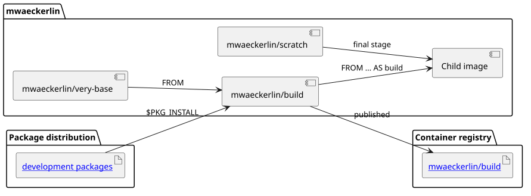
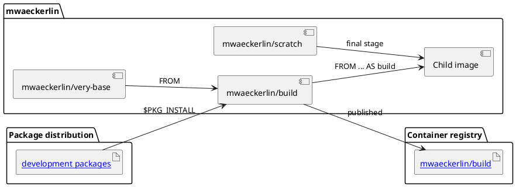
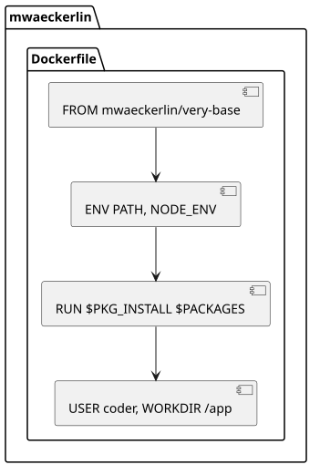
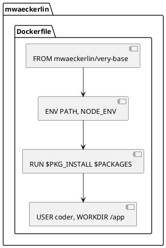
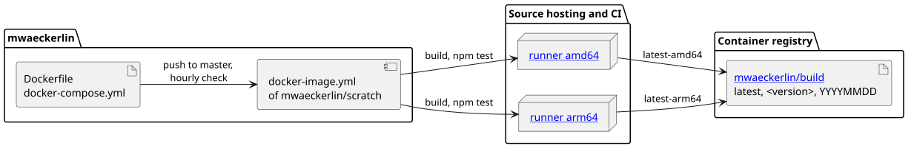
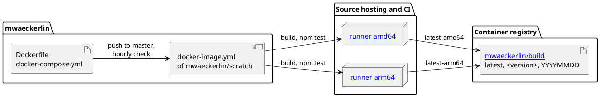

# mwaeckerlin/build architecture

| Entry | Value |
| --- | --- |
| Subject | Image `mwaeckerlin/build` and its build |
| Reader | Administrator, developer |
| Basis | Source, [FEATURES.md](FEATURES.md) and [TESTS.md](TESTS.md) of this repository |
| Date | 2026-10-30 |

## 1. Introduction and Goals

The image is a [build stage](#build-stage) base with the usual tools of a build; it is never deployed.

### 1.1 Requirements overview

The image carries a C and C++ tool chain, autotools, git, gpg, curl, Node.js of the current LTS (Alpine package `nodejs-current`) with npm and yarn, Python with pip, PHP, Ruby, upx and the development files of OpenSSL, zlib, libffi and readline, replaceable by the build argument `PACKAGES` (F1). Builds run as `coder` in `/app` (F2), system commands win over tools of `node_modules/.bin` (F3), `NODE_ENV` is `development` (F4), and the image is published for amd64 and arm64 (F5).

### 1.2 Quality goals

| Priority | Goal | Meaning here |
| --- | --- | --- |
| 1 | Separation | The build user `coder` owns what it builds; the run user `somebody` of the final stage cannot overwrite it |
| 2 | Safe command lookup | A package of `node_modules` never shadows a system command |
| 3 | Completeness | A typical build finds its tools without an install of its own |

### 1.3 Stakeholders

| Role | Expectation |
| --- | --- |
| Developer of a child image | Uses `FROM mwaeckerlin/build AS build` and copies the result into the [runtime base](#runtime-base) |
| Developer of this image | Changes the package list and runs `npm test` |

## 2. Architecture Constraints

The constraints come from the image family.

### 2.1 Technical constraints

The image is built on `mwaeckerlin/very-base`, the build base of the family, and installs its tools from the [package distribution](#package-distribution). It is for build stages only and therefore keeps its shell.

### 2.2 Organisational constraints

The rules of the image family apply to every image of this repository: `master` is the only branch, a version number is never written into a Dockerfile, a setting of the operator is an environment variable with a default, and every image is built and published by the reusable workflow `docker-image.yml` of `mwaeckerlin/scratch`.

## 3. Context and Scope

The image is used by the Dockerfiles of other images and never runs as a service.

### 3.1 Business context

PlantUML source

### 3.2 Technical context

| Interface | Protocol or form | Direction | Features |
| --- | --- | --- | --- |
| Build argument `PACKAGES` | package list | in | F1 |
| `/app` | working directory of the child build | in and out | F2 |
| `ENV PATH`, `ENV NODE_ENV` | environment of the child build | out | F3, F4 |

## 4. Solution Strategy

- One `RUN $PKG_INSTALL $PACKAGES` installs the list, so a child build replaces it with one build argument.
- `PATH` lists the system directories first and `node_modules/.bin` and `/app/node_modules/.bin` last.
- The image ends as `USER coder` in `WORKDIR /app`.

## 5. Building Block View

The image has one stage; its building blocks are the instructions of the Dockerfile.

### 5.1 Whitebox of the image

PlantUML source

| Block | Responsibility | Source |
| --- | --- | --- |
| `PACKAGES` | The list of tools | `Dockerfile` |
| `PATH`, `NODE_ENV` | Command lookup and development dependencies | `Dockerfile` |

## 6. Runtime View

The image runs only inside the build of a child image.

### 6.1 Build of a child image

1. The child Dockerfile starts a stage `FROM mwaeckerlin/build AS build` and copies its sources with `--chown=${BUILD_USER}`.
2. Its build steps run as `coder` in `/app` with the tools of the image.
3. A final stage `FROM mwaeckerlin/scratch` copies the result out of `/app`.

## 7. Deployment View

The image is built and published by the workflow of the family; it is pulled by builds and never deployed.

### 7.1 Build and publication

A push to `master`, a manual start and the hourly check start `.github/workflows/docker.yml`, which calls the reusable workflow `docker-image.yml` of `mwaeckerlin/scratch`. The workflow builds every image of the compose file on one runner of the [source hosting and CI](#source-hosting) per architecture, amd64 and arm64, runs `npm test` there, pushes the tested image under an architecture tag to the [container registry](#container-registry) and then joins the architectures under the tags `latest`, `YYYYMMDD`, `<version>` and `<version>-YYYYMMDD`, the version read from `package.json`. The hourly check builds only when a parent image or a download changed, or when the published image is a week old.

PlantUML source

## 8. Cross-cutting Concepts

The concepts below apply to every building block.

### 8.1 Security

`PATH` puts the system directories before the relative entries, so an npm package cannot shadow a system command (F3); the README names the trade-off of the relative entries.

### 8.2 Tests

`npm test` runs the docs contract and `tests/config-contract.sh`, which looks for every tool and header, compiles a C program in `/app`, checks the user, the command lookup and `NODE_ENV`, and builds the image once more with `PACKAGES=bash`. [TESTS.md](TESTS.md) lists every test with its feature.

## 9. Architecture Decisions

The decision below shapes the Dockerfile.

### 9.1 Shell kept

A build stage needs a shell and a package manager, so this image is no [headless](#headless) image; its result goes into a headless final stage.

## 10. Quality Requirements

The scenarios below are measured by the tests named.

### 10.1 Quality scenarios

| Scenario | Expected result | Test |
| --- | --- | --- |
| `node_modules/.bin/ls` exists | the system `ls` runs | `tests/config-contract.sh` › system_command_wins_over_node_modules |
| `PACKAGES=bash` | bash is installed, the default tool chain is not | `tests/config-contract.sh` › packages_replace_the_list |

## 11. Risks and Technical Debt

The items below are open in [TODO.md](TODO.md).

### 11.1 Licence

The repository carries no `LICENSE`.

## 12. Glossary

The terms of this document and the providers of its external dependencies.

### 12.1 Terms

| Term | Meaning |
| --- | --- |
| Headless | The delivered image carries no shell, no interpreter and no package manager, only the program it runs and its libraries |
| Build stage | A `FROM` stage of the Dockerfile that compiles or collects files and is not part of the delivered image |
| Runtime base | `mwaeckerlin/scratch`, the empty image with the users of the family that every delivered image of the family starts from |

### 12.2 Logical designations

The external dependencies stand under their function in this document; the table names who provides them.

| Logical designation | Description | Company in the UK | Company in Switzerland |
| --- | --- | --- | --- |
| Source hosting and CI | Holds the git repository and runs the workflow on its runners for amd64 and arm64 | GitHub, Inc. | GitHub, Inc. |
| Container registry | Serves the published images and the parent images a build pulls | Docker, Inc. | Docker, Inc. |
| Package distribution | Delivers the packages of `PACKAGES`, installed on `mwaeckerlin/very-base` | Alpine Linux project, no company | Alpine Linux project, no company |
